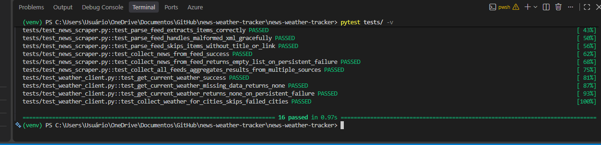
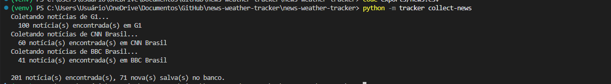
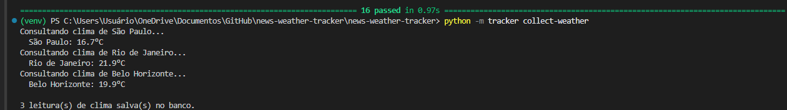
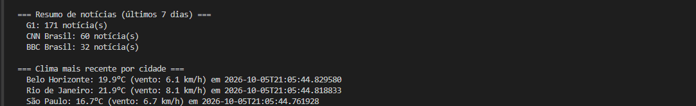
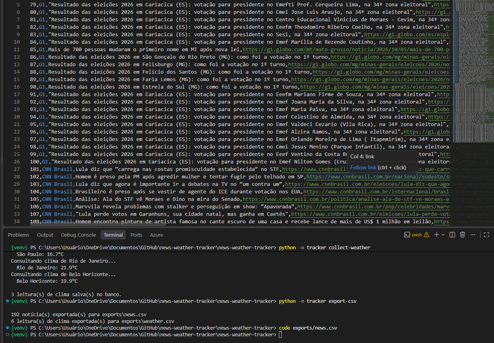

# News & Weather Tracker 📰🌤️

Coletor de notícias (via feeds RSS) e dados de clima (via API pública), com histórico salvo em SQLite, relatórios e exportação para CSV.

## Por que esse projeto existe

A maioria dos tutoriais de "web scraping" ensina a extrair dados direto do HTML de um site — algo que quebra a cada mudança de layout e muitas vezes viola os termos de uso da página. Este projeto usa uma abordagem mais profissional:

- **Notícias via RSS**: feeds RSS são publicados pelos próprios portais justamente para consumo automatizado — estável, estruturado e sem problemas de permissão.
- **Clima via API pública**: usa a [Open-Meteo](https://open-meteo.com), gratuita e sem necessidade de cadastro ou chave de API.

O projeto também resolve problemas reais de um coletor de dados: deduplicação (não salvar a mesma notícia duas vezes), retry automático quando uma fonte está instável, e histórico persistente para análise posterior.

## Funcionalidades

- Coleta notícias de múltiplos feeds RSS configuráveis
- Coleta clima atual de múltiplas cidades (Open-Meteo)
- Banco de dados SQLite com histórico completo
- Deduplicação automática de notícias (por link)
- Retry com backoff exponencial em falhas de rede
- Relatório resumido (notícias por fonte, clima mais recente por cidade)
- Exportação para CSV
- 16 testes automatizados, todos usando mocks (rodam sem precisar de internet)

## Demonstração

**Testes automatizados passando (16/16):**



**Coleta de notícias dos feeds RSS configurados:**



**Coleta de clima das cidades configuradas:**



**Relatório resumido (notícias por fonte + clima mais recente):**



**Exportação para CSV, com dados reais coletados:**



## Instalação

```bash
git clone <url-do-repositorio>
cd news-weather-tracker
python -m venv venv
source venv/bin/activate  # Windows: venv\Scripts\activate
pip install -r requirements.txt
```

## Como usar

**Coletar notícias dos feeds configurados:**
```bash
python -m tracker collect-news
```

**Coletar o clima atual das cidades configuradas:**
```bash
python -m tracker collect-weather
```

**Ver um resumo dos dados coletados:**
```bash
python -m tracker report
python -m tracker report --days 30    # janela de dias customizada
```

**Exportar os dados coletados para CSV:**
```bash
python -m tracker export-csv
python -m tracker export-csv --output-dir meus_dados
```

### Exemplo de saída do `report`

```
=== Resumo de notícias (últimos 7 dias) ===
  G1: 15 notícia(s)
  CNN Brasil: 9 notícia(s)
  BBC Brasil: 6 notícia(s)

=== Clima mais recente por cidade ===
  São Paulo: 23.5°C (vento: 8.0 km/h) em 2026-01-01T10:00:00
  Rio de Janeiro: 27.1°C (vento: 12.3 km/h) em 2026-01-01T10:00:05
```

## Customizando fontes e cidades

Edite `tracker/config.py`:

```python
NEWS_FEEDS = [
    ("G1", "https://g1.globo.com/rss/g1/"),
    ("Seu portal favorito", "https://exemplo.com/rss"),
]

CITIES = [
    ("Sua cidade", -23.5505, -46.6333),  # latitude, longitude
]
```

## Rodando os testes

```bash
pytest tests/ -v
```

Todos os testes usam `unittest.mock` para simular as respostas de rede — não fazem chamadas reais, então rodam rápido e de forma confiável em qualquer ambiente (inclusive CI/CD).

## Automatizando a coleta (opcional)

Para coletar dados periodicamente, agende via `cron` (Linux/Mac) ou Agendador de Tarefas (Windows):

```bash
# Exemplo de crontab: coleta a cada hora
0 * * * * cd /caminho/do/projeto && venv/bin/python -m tracker collect-news && venv/bin/python -m tracker collect-weather
```

## Estrutura do projeto

```
tracker/
├── __main__.py        # Ponto de entrada (python -m tracker)
├── cli.py              # Interface de linha de comando
├── config.py           # Feeds RSS e cidades configuradas
├── database.py         # Camada de acesso ao SQLite
├── news_scraper.py     # Coleta e parsing de feeds RSS
├── weather_client.py   # Cliente da API Open-Meteo
├── export.py           # Exportação para CSV
└── retry.py            # Decorator de retry com backoff exponencial
tests/
├── test_database.py
├── test_news_scraper.py
└── test_weather_client.py
```

## Possíveis evoluções

- Dashboard web simples (Flask) para visualizar os dados
- Alertas (e-mail/Telegram) quando uma notícia contém palavras-chave específicas
- Análise de sentimento das manchetes coletadas
- Gráficos de variação de temperatura ao longo do tempo

## Stack

`Python 3` `SQLite` `requests` `argparse` `pytest` `unittest.mock`
